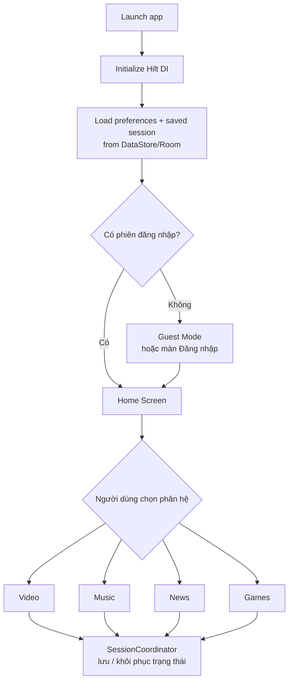
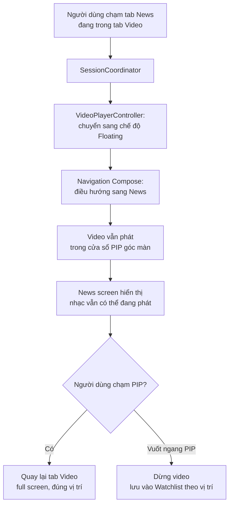
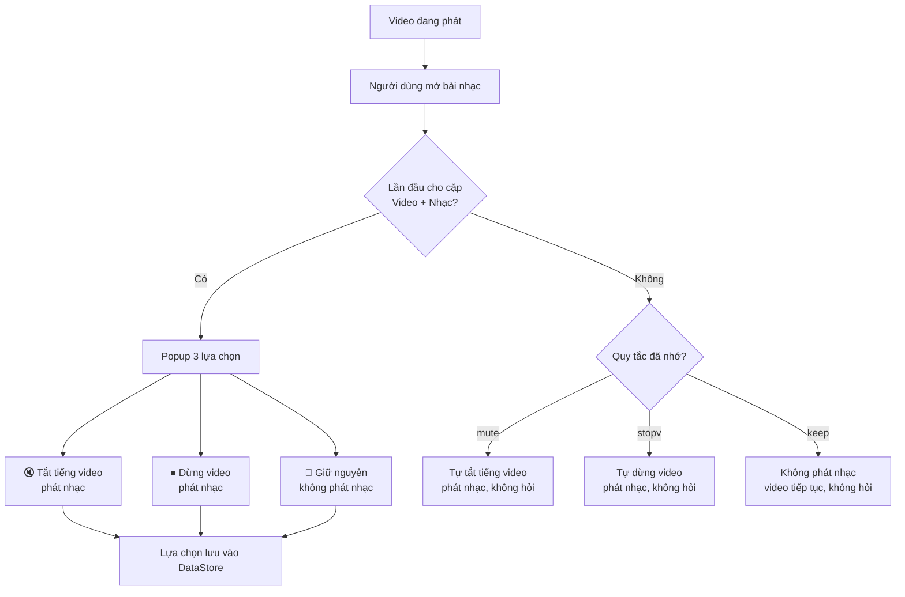
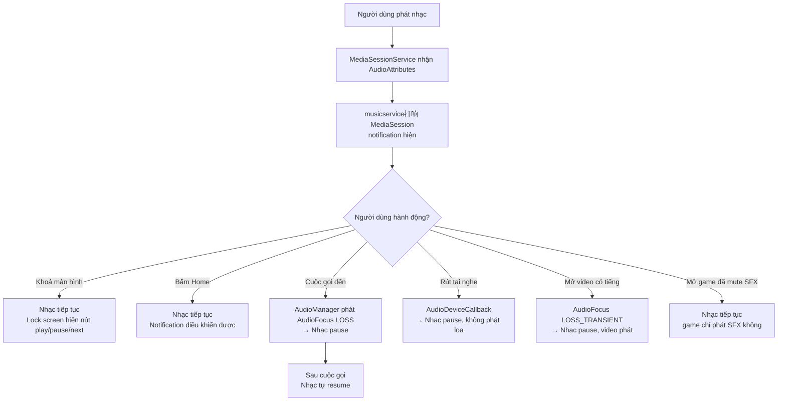
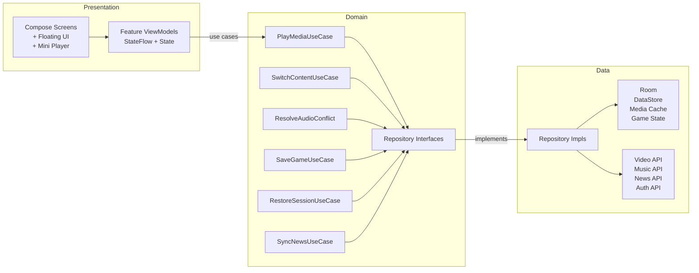
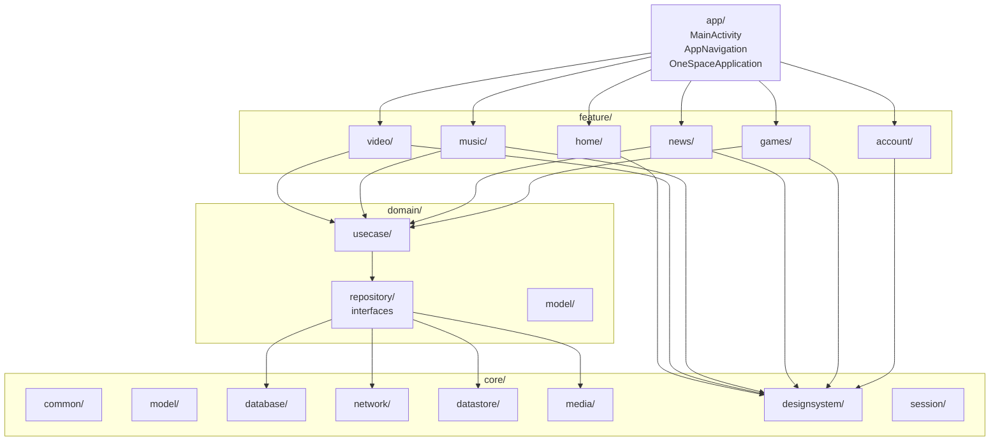
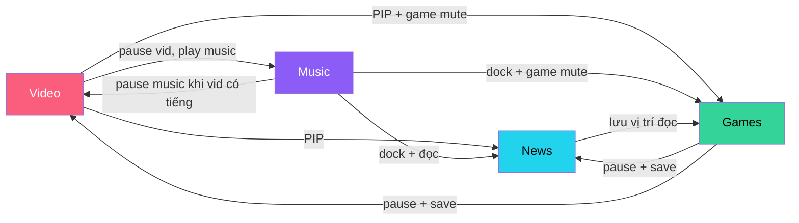
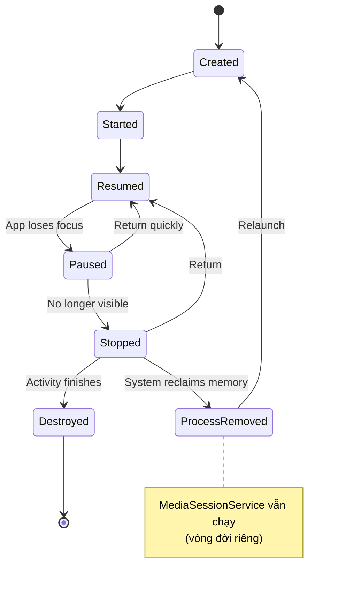
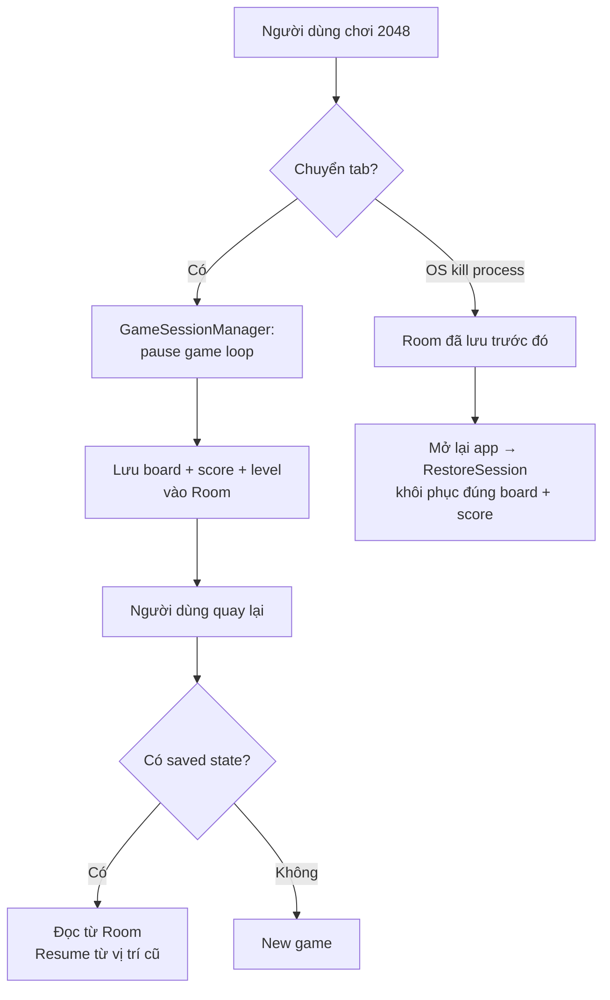
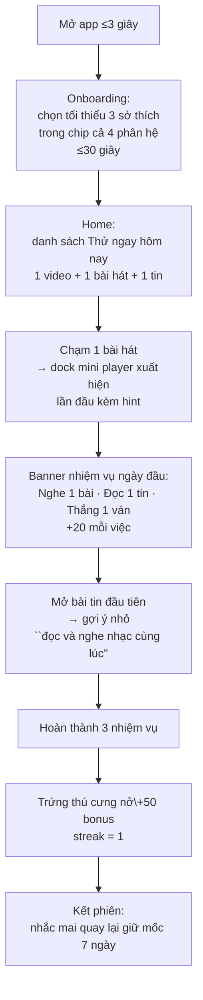

# OneSpace — Mermaid flows để review

Dán các sơ đồ dưới đây vào các công cụ render Mermaid (VS Code Mermaid Preview, GitHub, [mermaid.live](https://mermaid.live)).

---

## 1. Execution Flow — từ launch đến Home

---

## 2. SessionCoordinator — chuyển tab Video → News (case C3)

---

## 3. Audio Focus Conflict — Video + Music (case C1)

---

## 4. Background Audio Playback — Music khi khoá màn

---

## 5. Kiến trúc 3 lớp

## 6. Module structure

---

## 7. Ma trận chuyển tab — hành vi tổng quan

---

## 8. Activity Lifecycle vs MediaSessionService

---

## 9. Game Session Save/Resume

---

## 10. First-run (phiên đầu tiên)

